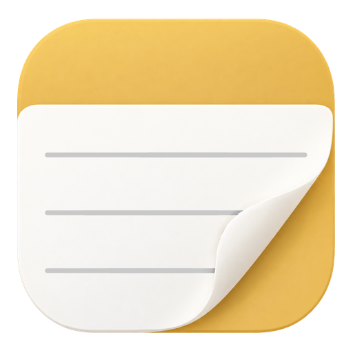
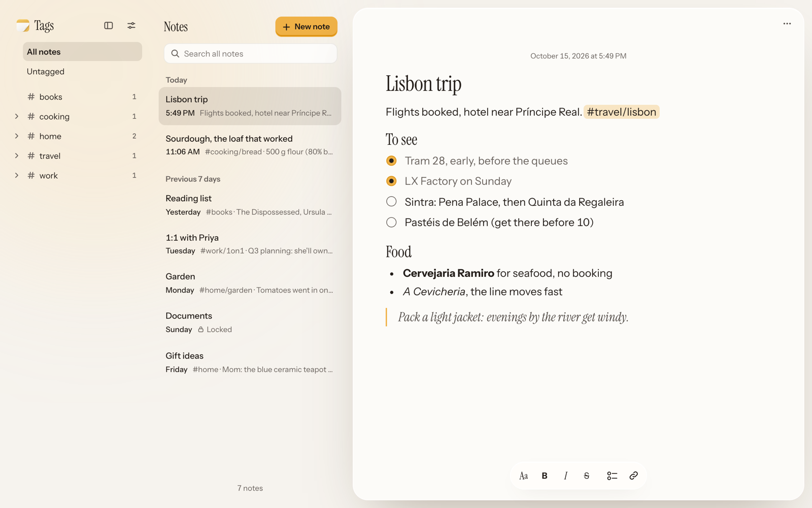

<p align="center"></p>

<h1 align="center">notesd</h1>

<p align="center">A self-hosted notes app that stays out of your way. The server is a single lightweight
binary you can drop onto a Raspberry Pi or a cheap VPS. The Android app works fully
offline and syncs your notes in the background whenever a connection is available.</p>

<picture>
  <source media="(prefers-color-scheme: dark)" srcset="docs/images/web-dark.png">
  
</picture>

## Features

**Search.** Full-text search across titles and bodies, with title
matches ranked higher and formatting ignored. On Android it queries the local
database, so it works offline.

**Organize with tags.** Write `#work` in a note and it's tagged. The sidebar
lists all your tags, so you can browse by topic. Tags can be nested with `/`
(`#home/garden`).

**Images.** Add photos to a note from the toolbar, or paste or drop them on the
web. They're downscaled and stripped of location data before upload, and on
Android you can add them offline.

**Locked notes.** Lock any note and its body is encrypted on-device with AES-256-GCM before
they're saved or synced, so the server only stores ciphertext. Unlock with a
password, a passkey (web) or biometric (Android).
See [Security](#security) for more details on what this does and doesn't protect.

## Get started

1. **Host the server.** Download the binary for your machine, run it, and put
   HTTPS in front of it. See [docs/hosting.md](docs/hosting.md).
2. **Create your account.** Open the setup link the server prints on first
   start and choose a username and password.
3. **Install the Android app.** Download the APK from
   [Releases](https://github.com/cassiozen/notesd/releases) and connect it to
   your server. See [docs/android.md](docs/android.md).

| Platform | Status |
| --- | --- |
| Server | Linux x86-64 and ARM64 (including Raspberry Pi), macOS on Apple silicon |
| Web | Built into the server; current Chrome, Safari, Firefox and Edge |
| Android | Android 9 or later |
| iOS | Not started |

## Security

Regular notes are stored unencrypted on your server. Use disk encryption if that
matters to you, and HTTPS for anything reachable from the internet.
The Android app won't send your password over plain HTTP outside your local network.

**Locked notes** are the exception, but within limits:

- **What the server still sees.** Titles, dates and tags written in the title
  stay readable, and locked notes can't be searched by their text or emailed.
- **Text from before locking.** When you lock a note, the server scrubs the
  previous text from its database. Backups made earlier still hold it.
- **Images.** A locked note's images are encrypted too. Images from before
  locking, and images you remove from any note, stay on the server: nothing
  deletes images yet.
- **Forgotten passwords.** If you forget the lock password and have no
  passkey or fingerprint set up, those notes can't be recovered.

The full threat model is in
[docs/architecture.md §10.1](docs/architecture.md#101-locked-notes).

## Your data

Everything the server knows lives in one SQLite file, `notes.db`, in the data
directory. SQLite runs inside the server process, so there's no database server
to run and a query is a function call instead of a network round trip. On an NVMe
drive a commit takes a fraction of a millisecond, and a single file is easy to 
back up and move.

The database runs in **WAL mode**. Search uses **FTS5**.

Notes are stored as Markdown, and you can take them out as plain files at any
time:

```bash
notesd export --out ~/notes-export
```

Each note becomes a `.md` file named after its title. Locked notes are left
out unless you add `--include-locked`, which asks you to confirm and to type
the lock password, then writes them unencrypted. The command only reads the
database, so it's safe to run while the server is up.

## How it's built

| Part | Stack |
| --- | --- |
| Server | Go, `net/http`, SQLite with WAL and FTS5 |
| Web | React, TypeScript, Tiptap/ProseMirror, Vite; embedded in the server binary |
| Android | Kotlin, Jetpack Compose, a native `EditText` editor, bundled SQLite with FTS5, WorkManager |

A few things that may be interesting if you're reading the code:

- **One spec.** [docs/architecture.md](docs/architecture.md) is the
  specification: data model, sync protocol, conflict rules, Markdown dialect,
  search ranking and the locked-notes design. Changes to any of those start
  there.
- **Shared rules.** The three platforms implement the Markdown round trip,
  plain-text extraction, tag parsing and the locked-notes crypto separately.
  Fixtures in [`shared/`](shared) pin all four, and every platform's tests run
  against them, so the server, the web app and the phone agree.
- **Simple sync.** Each note has a revision, and the server keeps a global
  change sequence. Clients push edits against the revision they started
  from, and pull everything changed since a cursor. There are no CRDTs and
  no WebSockets.
- **No other services.** No Postgres, Redis, queue or search engine: search
  is SQLite's FTS5, and the whole state is one database file.

## Documentation

| Guide | For |
| --- | --- |
| [Hosting](docs/hosting.md) | Installing and configuring the server, HTTPS, systemd |
| [Android](docs/android.md) | Installing the app, connecting, how sync works |
| [Operations](docs/operations.md) | Upgrades, maintenance, monitoring |
| [Development](docs/development.md) | Building from source and working on notesd |
| [Architecture](docs/architecture.md) | How it works: data model, sync protocol, conflicts |
| [Server API](server/README.md) | The HTTP API reference |
